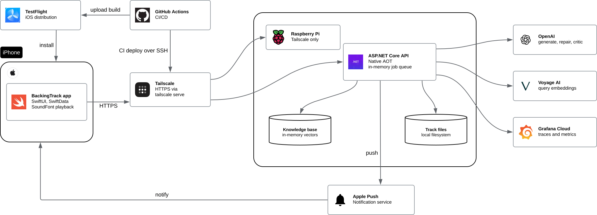

# backing-track-ai

A Raspberry Pi-hosted .NET application that uses an agentic AI workflow (built with Microsoft Agent Framework) to generate musical backing tracks for guitar practice, with validation, repair and a rule-based fallback guarding against bad output. The iOS client app allows for customisable tracks to be generated for a chosen chord progression, tempo, and style. The project was developed largely as an exercise in AI-centric engineering, but also to be practically useful to the author.

For the full project scope, please see the [docs/backing-track-generator-scope.md](docs/backing-track-generator-scope.md).

## Overview

The project generates tracks in one of two modes. **Precise mode** (built) produces chord-locked, note-by-note tracks that the app plays on-device with sampled instruments. **Vibe mode** (planned) would instead return a rendered audio file from a third-party service, trading chord accuracy for a more realistic sound.

### Core flow

1. User selects a key, style, chord progression, time signature and tempo
2. App sends a request to the backend at `POST /tracks/generate`. The API returns a `202` response along with a unique job ID
3. User can choose to watch the progress of their generating track, which includes messages published from the API about what stage of the process is active, and any validation failures/critic rejections. Updates are pulled by the app using `GET /tracks/status/{jobId}`
4. Alternatively the user can dismiss the progress screen and carry on. The user is notified via APNs push notifications when a track is ready
5. Once the track is complete, `GET /tracks/download/{trackId}` downloads a JSON file that describes the notes of the track
6. The `AVFAudio`-powered audio engine converts the JSON into a playable sequence of notes, which are then played using sampled instruments
7. During playback, which is fully offline, the track tempo can be adjusted as needed, as well as the volumes of any of the tracks
8. All downloaded tracks are stored locally in-app using SwiftData and can be replayed from a history screen at any time

If the AI generation can't produce a valid track within its attempt limits, the API falls back to a rule-based generator and the job still completes. The app marks these tracks as arranged with the built-in fallback rather than the model. A job that fails outright is shown as failed, with no track to download.

### Backend

Backing tracks are generated asynchronously via an in-memory queue, using a multi-step workflow (see diagram below).

The results of the workflow are not audio files, but JSON files containing definitions of MIDI notes, with three tracks (bass, drums, and chords). Client applications are responsible for playing the tracks after downloading these JSON files.

The application is self-hosted on a Raspberry Pi, reachable from a private Tailscale network.

### Client

The client is a native iOS application built using SwiftUI. The app includes an audio engine (built using Apple's AVFAudio libraries), which uses sampled instruments and sequencers to play the tracks. A history of previously generated tracks is kept to be replayed without the need of a network connection.

## Architecture

### System



The iOS app talks to the ASP.NET Core API on a Raspberry Pi over a private Tailscale network, to avoid exposing it to the public internet. GitHub Actions deploys the API to the Pi and uploads iOS builds to TestFlight. The Pi also holds a set of pre-computed vector files, loaded into memory for use in style context retrieval, as well as the output JSON files for each track.

Jobs themselves are held in memory and processed one at a time in a queue. The in-memory storage means that jobs mid-run can be lost on restart of the API, but this is acceptable for the time being. A future enhancement could be to store jobs in a database such as PostgreSQL instead. The following external services are also used:

- APNs: push notifications are sent on completion of backing tracks
- OpenAI: LLM calls are used in the Generate, Repair, and Critic steps discussed further below
- Voyage AI: used for text vector embedding in the context retrieval stage. Currently only the style information is retrieved using embedding
- Grafana Cloud: telemetry on track generation jobs (duration, tokens used, validation/critic attempt counts, status etc.) is pushed to Grafana via an OpenTelemetry (OTel) Collector running on the Pi

### Generation workflow


The workflow is built with [Microsoft Agent Framework](https://github.com/microsoft/agent-framework) as a fixed graph of executors joined by explicit edges ([`GenerationWorkflowBuilder`](api/src/BackingTrack.Generation/Workflows/GenerationWorkflowBuilder.cs)). Three of the steps call an LLM, and the others (retrieval, validation, the fallback and persistence) are ordinary code. The graph, not the model, decides what happens next: the LLM produces and critiques tracks, and the code routes on the result. This is deliberate, so that the control flow stays predictable. For example, the critic's tool is declared but never auto-invoked, so there is no open-ended tool-calling loop ([ADR 0029](docs/adr/0029-critic-tool-call-over-per-criterion-structured-output.md)).

#### Normal path

Once a job has been accepted and reaches the front of the queue, the first stage in the workflow is to retrieve additional context for the generation agent to use. Style info is looked up from the vector knowledge base using Voyage AI's embedding model. Other context like chord and scale details are retrieved using deterministic rules. The Generate agent takes the user's request and retrieved context and builds a prompt to send to an LLM, the result of which is the JSON representation of a candidate track.

The candidate is run through a deterministic validation stage, which catches issues such as a track that doesn't have the required number of bars; notes outside the expected instrument's range; notes that don't fit the chosen chords/scales; empty bars etc. A music critic agent takes the candidate track, the user's original request and the retrieved context, and evaluates whether it passes a set of defined quality criteria. All criteria must be passed before the final track is persisted to the Pi's local storage with a unique ID, to be downloaded later by the iOS app.

#### Resilience strategies

Should the deterministic validator find any issues, they are passed to a repair step. The repair step calls an LLM to create a patch, which is then applied to the candidate track to fix the problems identified. This loop continues until the validator finds no more issues, up to a [configurable](api/README.md#configuration) maximum number of attempts. The critic step, should any of its criteria not pass, sends any citations back to the generate step so that a new track can be generated armed with what went wrong in the previous run. This critic/generate loop can also repeat a configurable number of times.

In the event the maximum number of validation or critic attempts is exceeded, or if an LLM call should fail, a fallback process is triggered. The fallback stage uses a rule-based system to generate a track deterministically. This is intended to ensure the user always gets something usable out of a run. The fallback-generated track still goes through the deterministic validation as a sense-check, but it is not evaluated by the critic.

## Headline decisions

### Resilience

Due to the non-deterministic nature of the LLM calls used to generate the track, several mechanisms had to be put in place to help guarantee the user will receive a usable track. Different layers are used for different purposes, e.g. a deterministic validator to catch objectively wrong notes (or the absence of any notes), and a more subjective critic to measure musical quality.

When the validator finds problems, the LLM isn't asked to regenerate the whole track, but to produce a patch of field-level corrections. The first implementation regenerated the entire track on every retry, which ran into output token limits on larger tracks and meant that the cost of a repair scaled with the size of the track instead of the size of the problem.

Only a track that passes validation reaches the critic, which judges what the validator can't: musical quality. Because the validator already guarantees that the notes are legal, the critic assumes that and doesn't re-check it. When it was asked to, it kept rejecting valid scale tones as being outside the chord.

If all else fails, a rule-based generator builds a deterministic track instead. It deliberately skips the critic: a critic rejection sends a track back to the LLM, so routing the fallback track through it could loop straight back into the pipeline that had just failed. The job finishes in its own `CompletedViaFallback` state, so the fallback rate can be reported separately from genuine LLM successes.

*Related ADRs: [0017](docs/adr/0017-patch-based-track-repair.md) patch-based repair; [0028](docs/adr/0028-silent-bar-repair-via-whole-part-replacement.md) silent-bar repair; [0029](docs/adr/0029-critic-tool-call-over-per-criterion-structured-output.md) the critic's single verdict; [0033](docs/adr/0033-critic-assumes-pitch-legality-instead-of-rechecking-it.md) validator and critic split of responsibilities; [0034](docs/adr/0034-rule-based-fallback-generator-bypasses-critic.md) rule-based fallback.*

### Eval

Eval applications - written as .NET console apps - were created to enable informed decisions around model selection and prompt tuning. The eval harness applications run the real in-process workflow against a golden set of test cases. During these test runs, the generation eval records the run duration, estimated cost, number of validation attempts, number of critic review loops, etc. The written results and the decisions made as a result are in [docs/eval-results.md](docs/eval-results.md), and the raw run reports are in the [docs/eval-results/](docs/eval-results/) directory.

The generation eval judges each case with deterministic checks only: the expected outcome (success, fallback or failure) and bounds on the number of attempts. It deliberately doesn't try to judge whether a track sounds good. Some cases use fault injection to force the failure paths, such as a critic rejection or an LLM outage, so those paths are exercised on purpose and not left to chance.

The critic has its own eval because it needs a different kind of test. It reviews hand-built fixture tracks with a known-correct verdict, each repeated ten times to measure consistency. In the first run the two models tested failed the "good" fixtures in 23% to 37% of runs, always citing voice leading. Reading the citations showed that two of those fixtures really did contain parallel-motion defects, so the fixtures were revoiced and the eval rerun, after which all three models in the rerun matched the expected verdict in every run.

The evals are run by hand against the live APIs, because each run costs tokens, so they aren't part of CI. Recording and replaying LLM responses would need to come first.

*Related ADRs: [0027](docs/adr/0027-generation-eval-harness.md) generation eval harness; [0030](docs/adr/0030-critic-eval-as-a-separate-code-based-project.md) separate critic eval; [0036](docs/adr/0036-per-step-model-tier-split-for-cost.md) per-step model and tier split; [0049](docs/adr/0049-gpt-6-1-sol-for-generation.md) choosing `gpt-6.1-sol` for generation.*

### Telemetry

The project was built to capture realistic telemetry using the industry-standard OpenTelemetry format. The telemetry data was required to be able to measure performance in a quantitative way.

*Related ADRs: [0010](docs/adr/0010-opentelemetry-tracing-and-metrics.md) OpenTelemetry tracing and metrics; [0011](docs/adr/0011-hosted-otel-backend-static-collector-config.md) hosted Grafana Cloud backend and static collector config; [0044](docs/adr/0044-metric-and-span-naming-and-tag-conventions.md) metric and span naming conventions.*

### In-memory store and queue

For a personal project with only one user, having a persistent database like PostgreSQL wasn't a priority. Instead generation job states are stored for the lifetime of the .NET API and are removed through a scheduled cleanup task, or lost on restart. It is possible for mid-flight jobs to be lost, as well as rate-limiting counters, but given the current use case these are acceptable trade-offs. The generated tracks themselves are not held in memory: they are written to the Pi's disk and survive restarts, and the iOS app keeps its own copy of each track once it has been downloaded, so losing a job's state doesn't lose the track. The main cost is that a finished job which the app hasn't picked up before it is cleaned up will show as lost, even though its track file is still on disk. A possible future improvement is to add a PostgreSQL job store implementation that can be swapped in if required.

*Related ADRs: [0013](docs/adr/0013-async-job-based-generation-invocation.md) async job-based generation; [0043](docs/adr/0043-ttl-eviction-of-finished-jobs-from-the-in-memory-store.md) TTL eviction of finished jobs; [0014](docs/adr/0014-local-filesystem-track-storage.md) track storage on the local filesystem; [0012](docs/adr/0012-builtin-rate-limiting-per-process-hashed-key.md) in-process rate limiting; [0015](docs/adr/0015-in-memory-vector-retrieval-for-rag-kb.md) in-memory vector store.*

### Tech stack

The backend server was built in C# with ASP.NET Core, as that is a language and framework the author was already familiar with. The API is published as Native AOT, a deliberate choice made partly to learn the approach and partly for a small, fast-starting binary on a Raspberry Pi. The practical benefit is modest for a long-running, single-user service, and the cost is real: every new dependency needs its own AOT-safety check. [ADR 0008](docs/adr/0008-agent-framework-aot-compatibility.md) records the decision to stay on AOT despite that. One knock-on effect was that minimal APIs were used instead of MVC controllers.

The iOS application was written in Swift as a learning exercise, which is the main reason it was chosen over say, React Native, which could have been used to support Android clients as well.

Claude Code was used throughout as an assistant. The backend is mainly hand-written, with Claude Code used for review, unit tests and refactoring, while much of the SwiftUI app was generated with it under the author's direction and review. The ADRs were drafted from design discussions with it and then reviewed. [`CLAUDE.md`](CLAUDE.md) has the detail.

*Related ADRs: [0008](docs/adr/0008-agent-framework-aot-compatibility.md) staying on Native AOT; [0001](docs/adr/0001-minimal-apis-over-controllers.md) minimal APIs; [0007](docs/adr/0007-source-generated-json-for-aot-endpoints.md) source-generated JSON; [0009](docs/adr/0009-builtin-logging-over-serilog.md) built-in logging; [0018](docs/adr/0018-xunit-v3-and-nsubstitute.md) xUnit v3 and NSubstitute; [0019](docs/adr/0019-xcodegen-over-committed-xcodeproj.md) XcodeGen. The native iOS choice is covered in the [scope doc](docs/backing-track-generator-scope.md#platform).*

## Repository layout

| Path | What |
| --- | --- |
| [`api/`](api/README.md) | ASP.NET Core backend (Native AOT), deployed to a Raspberry Pi. |
| [`app/`](app/README.md) | Native iOS app (SwiftUI): track request form, generation progress and push notifications, job history, and on-device playback. |
| [`docs/`](docs/) | Project scope, [Architecture Decision Records](docs/adr/README.md) and [eval results](docs/eval-results.md). |
| [`api/eval/`](api/eval/README.md) | Generation and critic eval harnesses. |
| `api/local-observability/` | Docker Compose stack for running the OpenTelemetry backend locally. |
| `scripts/` | Pi bootstrap and the local Native AOT / trimming check. |

## Status

Precise mode works end to end: the iOS app submits a request, the Pi-hosted API generates the track in the background, the app shows progress and is sent a push notification when it is ready, and the track can then be played back offline and replayed from the history screen. API releases are tagged `api-v*` (the latest is `api-v0.1.6`), and iOS builds are uploaded to TestFlight on every push to `main` that touches the app.

The generation and critic evals have been run, with the results in [docs/eval-results.md](docs/eval-results.md). Prompt tuning for quality improvements is ongoing.

**Not built yet**

- Vibe mode (generative audio via a third-party service). It is planned, and the option is hidden in the app until a backend exists.
- The stretch goals from the [scope doc](docs/backing-track-generator-scope.md): a fretboard visualisation synced to playback, server-side audio export, and saved presets.

**Known limitations**

- Jobs are held in memory, so any that are mid-run are lost if the API restarts.
- The evals are run by hand and are not part of CI.
- The API is only reachable over Tailscale, and the app is built for a single user.

## Building

Requires the .NET 10 SDK (pinned in [`global.json`](global.json)).

```bash
dotnet build api/BackingTrack.sln
dotnet test --solution api/BackingTrack.sln
```

See [`api/README.md`](api/README.md) for local configuration and deployment.

Requires Xcode 26+ and [XcodeGen](https://github.com/yonaskolb/XcodeGen) for the iOS app — see
[`app/README.md`](app/README.md).

## License

[MIT](LICENSE).
